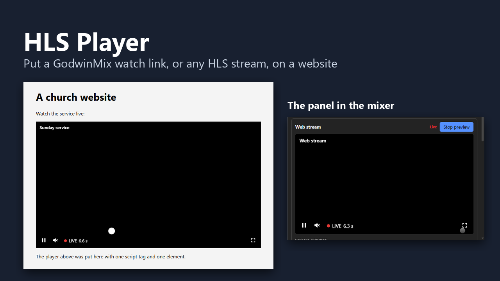

# HLS Player

A live video player you can put on any web page, and a GodwinMix panel that
writes the code for it. The panel lists every channel watch link on your
mixer, plays a preview of the one you pick, and has Copy buttons for an iframe
and for a script tag.

The player works with any HLS stream, not only GodwinMix. It is one small
script plus hls.js, and it makes no request except the stream itself (and the
poster, if you give one). No tracking, no analytics, no fonts from anywhere.



## Install

From the mixer: open **Plugins**, find **HLS Player**, press **Install**.

From a terminal on the mixer's machine:

```sh
gmx plugin add psmux/godwinmix-hls-player
```

There is no process to start and nothing to configure. Reload the mixer's page
and **HLS Player** is a tab beside the other panels. If you closed it, open
**Panels and layout** and bring it back from there.

On GodwinMix 0.3.9 the tab may not appear: see [Known issues](#known-issues).

## Make a watch link and copy the code

1. On the **Channels** tab, give the channel a watch link (**Watch link**, then
   **Make the link**). The panel also offers **Make a watch link** for every
   channel that has none.
2. Open **HLS Player**. Each watch link that is switched on has a card.
3. Press **Preview** to watch it in the panel, in the same player a website
   gets. Only one preview plays at a time.
4. Set the options at the top: start by itself, start muted, a poster image,
   a width and a title.
5. Press **Copy iframe code** or **Copy script tag code** and paste it into
   your site.

## The two ways to embed

An iframe, which works in any page builder that accepts HTML:

```html
<div style="position:relative;width:100%;aspect-ratio:16/9">
  <iframe src="https://psmux.github.io/godwinmix-hls-player/player.html?src=https%3A%2F%2Fstream.example.com%2Flive%2Findex.m3u8&amp;autoplay=1&amp;muted=1"
    title="Live video" style="position:absolute;inset:0;width:100%;height:100%;border:0"
    allow="autoplay; fullscreen; picture-in-picture" allowfullscreen></iframe>
</div>
```

Or a script tag and one element, when you can add scripts to the page:

```html
<script src="https://psmux.github.io/godwinmix-hls-player/player.js" defer></script>
<godwinmix-player src="https://stream.example.com/live/index.m3u8" autoplay muted></godwinmix-player>
```

Both keep 16:9 at whatever width the page gives them.

| Iframe parameter | Element attribute | What it does |
|---|---|---|
| `src` | `src` | The HLS playlist (`.m3u8`). Required. Only http and https addresses are loaded |
| `autoplay=1` | `autoplay` | Start playing without a press. Browsers allow this only when muted, so it starts muted unless you say `muted=0` |
| `muted=1` | `muted` | Start with the sound off. A viewer turns it on with the speaker button or M |
| `poster=` | `poster` | An image to show before the video starts |
| `title=` | `title` | A line of text over the top of the picture |

[https://psmux.github.io/godwinmix-hls-player/](https://psmux.github.io/godwinmix-hls-player/)
has a form that writes both snippets for any stream address.

What a viewer gets: play and pause, mute, full screen, a quality menu when the
stream offers more than one quality, and a readout of how many seconds behind
live the picture is. When they fall behind (after a pause, say) a **Go live**
button appears. If the stream drops, the player says **Offline** and tries
again by itself after 1, 2, 4, 8 and then every 10 seconds, so nobody has to
reload the page when the stream comes back.

Keys, once the player has focus: Space or K plays and pauses, M mutes, F is
full screen, L goes back to live. Every control is a real button and is
reachable with Tab.

## Before you put it on a public site

The viewer's browser fetches the stream itself. That has three consequences.

**The address has to be reachable from the viewer.** A watch link on your
mixer looks like `http://192.168.1.20:8080/hls/channel/live/watch-link/index.m3u8?key=...`.
That works on your own network and nowhere else. For a site on the internet,
put the stream at a public address: a CDN that pulls from the mixer, or the
mixer reachable through a reverse proxy at a public name. Type that address
in the panel's **Public address of this mixer** box and the code follows it.
The panel shows a warning under any address that is on your network only.

**A site served over https cannot play an http stream.** Browsers block it as
mixed content. Serve the stream over https (the reverse proxy or CDN does this).

**The stream has to answer with CORS headers.** The player on your site
fetches the playlist from another origin, so the stream must send
`Access-Control-Allow-Origin`. GodwinMix sends `Access-Control-Allow-Origin: *`
on its watch links and answers the preflight. A proxy or CDN in front of the
mixer has to pass that header on, or add its own.

**A page from the internet cannot reach into your network.** Chrome and Edge
stop a public page from fetching a private address such as `192.168.1.20`, so
the hosted player cannot play a watch link at its network address even on a
computer in the same building. That is why the panel's **Open the player**
opens such a link in the mixer's own copy of the player
(`/plugins/hls-player/ui/player.html` on the mixer) instead.

## Host the player yourself

The `ui` folder is the whole player: `player.html`, `player-page.js`,
`player.js`, `embed.js` and `vendor/`. Copy those to any web server and use that address in place of
`https://psmux.github.io/godwinmix-hls-player/`. The panel's **Player address**
box changes the address the code points at.

## Privacy

The player loads the stream, the poster if you set one, and its own copy of
hls.js from beside `player.js`. Nothing else. The iframe page sends no referrer.
GitHub Pages, which serves the hosted copy, keeps its own server logs as any
web host does.

## Known issues

Both are GodwinMix 0.3.9 behaviour, not this plugin's, and each has a way round it.

* **The panel's tab does not appear after installing.** 0.3.9 installs a plugin
  to `<plugins>/hls-player/1.0.0/` but serves panels from
  `<plugins>/hls-player/ui/`. Until a release reads the versioned folder, copy
  the `ui` folder up one level and reload the page:

  ```sh
  # Linux and macOS
  cp -R ~/.godwinmix/plugins/hls-player/1.0.0/ui ~/.godwinmix/plugins/hls-player/ui
  ```

  ```powershell
  # Windows
  Copy-Item -Recurse "$HOME\.godwinmix\plugins\hls-player\1.0.0\ui" "$HOME\.godwinmix\plugins\hls-player\ui"
  ```

* **After a channel's feed stops and starts again, new viewers may see
  Connecting forever.** The watch link's sound and picture playlists come back
  with different discontinuity numbers, and hls.js cannot line them up.
  Switching the watch link off and on in the channel's settings clears it.

## For developers

```sh
node --test tests/*.test.mjs        # the snippet builder, URL parsing and the panel's reading of channel.list
python3 tools/check_manifest.py     # the manifest names files that exist
tools/package.sh                    # the release archives, into dist/
```

`tests/live/check.mjs` runs the player and the panel against a real mixer in
headless Chrome or Edge; [tests/live/README.md](tests/live/README.md) says how.

## Licence

MIT, see [LICENSE](LICENSE). `ui/vendor/hls.min.js` is
[hls.js](https://github.com/video-dev/hls.js) 1.7.3 under the Apache License
2.0, kept unmodified with its licence in `ui/vendor/hls.js-LICENSE.txt`.
